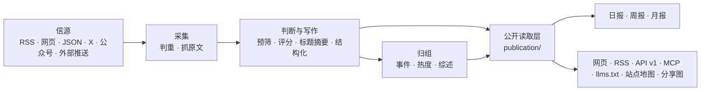

# 架构



## 三个进程

| 进程 | 位置 | 做什么 |
|---|---|---|
| api | `apps/api/` | Fastify。网站自用接口（`/api/site/`）、公开 API（`/api/v1/`）、RSS、MCP、后台接口、图片代理、分享图 |
| worker | `apps/worker/` | pg-boss 任务队列和定时任务：抓信源、调模型、归组、热度、日报、告警、清理 |
| web | `apps/web/` | React Router 服务端渲染的网页。只通过 HTTP 读 api，不碰数据库 |

业务代码都在 `packages/backend/`，前后端共用的类型和常量在 `packages/contracts/`。这个站自己的名字、文案、品牌和页面在 `site/`，行业的分类、信源、提示词和门槛在 `industry/`，只属于这个站的功能在 `modules/`（见下文“模块”）。

## 几条不变的规则

- **一个公开读取层**：网页、RSS、API、MCP、站点地图、分享图读的都是 `packages/backend/src/publication/`。公开范围、精选席位（机器出口每条新闻只出一条）与事实证据条件只在 `publication/scope.ts` 定义；新增出口也遵循当前的撤回和全文许可。已出刊报告保留当期写作，但引用是否可公开、来源名和引用时间仍按当前资料判断；撤回也要移除依赖该引用的导读与封面。
- **缓存不延长旧内容的寿命**：可变内容按响应的 `Cache-Control` 到期重新验证，站点地图的进程、磁盘与 HTTP 缓存共用同一个截止时间，不能在发送时重新计时；MCP 的 HTTP 响应使用 `no-store`。自建代理或 CDN 同样要遵守，配置要求见 [部署](deploy.md#配域名和-https) 的“配域名和 HTTPS”。
- **页面不调模型**：读者打开页面只读数据库里已经有的结果；模型只在 worker 的任务里调用。
- **花钱的请求有回执**：每个付费请求（模型、X、公众号、Jina、Codex 画图与搜图）先记一张回执，拿到结果先存再用。进程重启、任务重试时，复用已经付过钱的结果，不重复花钱（`providers/receipts.ts`）。结果不明的回执超过 30 分钟后自动放行一次；因它停在失败状态的文章会重新入队，继续未完成的正文提取或分析。再次结果不明时，由管理员在“运行”页核对后放行。
- **预算熔断**：每个付费服务有每分钟、每小时、每天的上限，超过就暂停（后台“设置 → 付费请求上限”）。分钟、小时按全部尝试限速；每日预算计入处理中、已返回结果和计费未知的尝试，明确未计费的失败不占每日额度。收到但无法解析的答案仍可能计费，继续计入；放行未知结果只允许重试，不抹掉旧尝试的预算，只有人工确认未计费才释放。
- **安全阀**：`COLLECT_ENABLED`、`MODEL_CALLS_ENABLED`、`FEISHU_CONTENT_PUSH_ENABLED`、`FEISHU_INTERNAL_ENABLED`、`INDEXNOW_SUBMIT_ENABLED`、`WECHAT_DRAFT_ENABLED` 只决定“发不发出去”，不决定走哪套逻辑；只有设成 `true` 才打开，没写就是关。`X_PUSH_ONLY=true` 时 X 账号不再走 SocialData 搜索，改由推送接口入库，RSS 和其他信源不变；没写就是继续付费搜索。`scripts/init-env.ts` 生成的 `.env` 会打开采集和模型调用，只调界面时可以改成 `false`；测试里推送一直关着，采集和模型调用只连本地假服务。
- **公开内容匿名**：管理员和访客看到的一样；读者的收藏、已读存在浏览器里。后台只允许管理员。
- **旧文不刷屏**：发现时已发布超过 48 小时的资料、新信源第一次导入的存量、回灌的推送，按原文时间归档，不进“今天”、不推送；第一次导入之后不再收列表里更早的存量。没有可信发布时间的资料先不公开，读到日期后再判断新旧。
- **来源可追溯**：每条精选都链接原文；站内是否显示全文由信源的 `site_fulltext` 决定，默认只显示摘要。
- **规则由所属模块维护**：后台调用内容、事件、通知与恢复模块，不直接改写它们的状态；业务模块不反过来依赖后台。人工修改、公开结果与恢复所需记录一起提交。
- **跨进程接口共享类型**：后台接口以 `packages/contracts/src/admin.ts` 为准，任务载荷以 `jobs/queue.ts` 的 `JobData` 为准，发送方和接收方一起检查。前端仍只通过 HTTP 访问后端。

这些模块边界由 `tests/architecture.test.ts` 检查；调整边界时同时更新约定与检查。站点身份和每一步的模型从 `site/` 读，行业分类和提示词从 `industry/` 读，代码里不写死某个站的值。

公开图片、分享图、手机海报和公众号封面的冷计算通过 `media.image` / `media.render` 交给 worker，API 只校验公开范围/签名或管理员权限、提交有界任务并读共享缓存；不允许在公开媒体请求失败时回到 API 渲染。缓存身份/读取在 `media/cards.ts`、`media/cache.ts`，API 请求协调在 `media/request.ts`，实际处理在 `jobs/media.ts`。跨进程任务保留原始 JSON 文本，确保既有内容指纹不受 JSONB 字段排序影响。启动和媒体请求（包括后台封面）的图像库隔离由真实独立进程测试检查。反馈截图等低频写入校验另行迁移。

## 目录

| 位置 | 内容 |
|---|---|
| `site/` | 这个站自己的：站名文案、每一步的模型、品牌与 Logo、条款页、网站根目录的四个固定文件（`public/`，替换占位符后发布）、更新日志，以及启用哪些模块（`site/modules/`） |
| `industry/` | 行业包：分类标签、主题、示范信源、提示词、门槛 |
| `modules/` | 只属于这个站的功能，一个功能一个文件夹（见下文“模块”）；框架本身不带模块 |
| `packages/backend/src/sources/` | 六种信源的读取器，抓取调度（`collect.ts`） |
| `packages/backend/src/content/` | 资料入库、判重、正文提取和清洗 |
| `packages/backend/src/editorial/` | 判断与写作：`analyze.ts`（流程）、`prompts.ts`（读提示词）、`models.ts`（每一步用哪个模型） |
| `packages/backend/src/events/` | 事件归组、热度、事件综述 |
| `packages/backend/src/publication/` | 公开读取层 |
| `packages/backend/src/reports/` | 日报、周报、月报 |
| `packages/backend/src/providers/` | 模型、向量、X、公众号、Jina、Codex 画图与搜图的调用，回执与预算 |
| `packages/backend/src/notify/` | 飞书推送 |
| `packages/backend/src/operations/` | 告警、备份、清理、IndexNow |
| `packages/backend/src/admin/` | 后台接口 |
| `apps/web/app/routes/` | 每个页面一个文件，路由表在 `apps/web/app/routes.ts` |
| `database/migrations/` | 数据库迁移，按完整文件名排序执行和记账 |
| `scripts/` | 初始化、迁移、种子数据、评测、检查脚本 |
| `tests/` | 后端测试（数据库名必须以 `_test` 或 `_ci` 结尾，见下文） |

## 模块

框架里没有、只有你这个站要的功能（比如一个专门的榜单或监控页），做成模块：一个功能一个文件夹 `modules/<名字>/`，是一个名为 `@aihot/<名字>` 的 npm 包，装着它自己的后端、接口、页面、样式、数据库迁移和测试。

| 文件 | 内容 |
|---|---|
| `module.ts` | 它的地址：页面、跳转、交给 api 处理的路径（类型见 `packages/contracts/src/modules.ts`） |
| `server.ts` | 它接进后端的插口：接口、定时任务、队列、事件回调、后台页面的数据等（`packages/backend/src/modules.ts`，每个插口注明读它的文件） |
| `web.tsx` | 它接进网页的插口：页面、导航项、主题页与后台的部件等（`apps/web/app/modules.ts`）；只在某一页出现的部件给出加载函数，随那一页的代码加载 |
| `migrations/` | 它自己的表，和 `database/migrations/` 一起按文件名排序执行 |
| `tests/` | 它的测试，`npm test` 一起跑 |
| 其他文件 | 它自己的图片等静态文件也放在模块文件夹里：在 `server.ts` 的 `http` 插口里注册路由，用 `apps/api/src/routes/static.ts` 的 `sendFile` 发出（类型、ETag、缓存头和 404 都由它处理，文件名自己校验），地址写进 `module.ts` 的 `apiPaths` |

写好以后在 `site/modules/` 的三份清单里列上它：`index.ts` 列地址，`server.ts` 列后端，`web.ts` 列网页，没有的那份不列；再在 `site/package.json` 的 `dependencies` 里写上它。用 Docker 部署的，在 `Dockerfile` 里照着其他包加一行 `COPY modules/<名字>/package.json modules/<名字>/`。框架的代码不导入任何模块，只读这三份清单，所以合并本仓库以后的更新时，不容易和你自己的功能冲突。插口不够用时，在框架里加一个通用的插口，而不是把这个功能写进框架。

网页模块通过 `web.tsx` 的 `messages` 插口提供自己的界面字典（按 `en`、`zh` 分组），由 `defineWebModule` 注册到引擎 `translate()`；英文键可以保留既有中文文案，需区别同名含义时用模块前缀的 key 并提供中文对应项。数据库公开内容的翻译仍由模块自己的读取层处理。

模块可在 `server.ts` 的 `workerStarted` 插口中安排首次任务；worker 在队列和定时任务注册完毕、心跳启动前调用它。网页的 `sidebar` 项由本站顶部导航展示；`module.ts` 的 `localizedPaths` 声明模块自己注册的 `/zh` 镜像，`timePaths` 声明跟随时间机器日期的页面。

模块可通过后端 `storyPage` 插口提供已发布的事件页补充内容：引擎的 `publication/stories.ts` 在确认事件可公开读取后调用它，结果按模块名放在 `StoryDetail.modules`。网页的同名插口懒加载对应部件；模块自己的 `backend/publication.ts` 负责审定状态和来源撤回检查，网页仍只读 HTTP。本站 `modules/story-depth/` 用它提供英文深度区块，集中审稿入口在 `/admin/review`。

模块通过 `agent.abilities` 提供 MCP 工具。`scripts/mcp-check.ts` 始终检查完整工具集合；模块可在 `mcp.checkArgs` 中提供能在空数据库上成功的检查参数。未提供时，只有入参 schema 接受 `{}` 的工具会用 `{}` 实际调用；其余工具只检查发现，不猜参数。模块工具的业务行为由模块自己的测试验证。

## 数据库迁移

已经发布的迁移是部署历史，不能改写或删除；修正放进新的文件。引擎和模块的迁移遵循同一套约定：按完整文件名排序执行，并以完整文件名记录是否已经执行；编号相同的不同文件分别执行，同一完整文件名不能出现在两个目录中。从 `0055` 起，每个文件只放一条允许在线执行的语句，发布前本地验证会拒绝不符合约定的新增迁移，也不允许用较小编号绕过检查。这样避免前一条语句锁住表后，又在同一事务里等待别的表或扫描大量数据。

新增列优先使用可空列或常量默认值；给已有表加 CHECK、外键时先 `NOT VALID`，再用另一个迁移验证。索引使用单独的 `CREATE INDEX CONCURRENTLY IF NOT EXISTS`；不能在发布迁移里做大批 UPDATE、DELETE 或用 DO 隐藏它们。数据回填需另做分批、可观测的操作，并先在备份副本上验证。

多个筛选条件存在相关性、查询计划因此严重低估行数时，可以为这些列创建 MCV 联合统计，再用单独的迁移 `ANALYZE` 指定表的这些列。先用真实分布验证收益；不增加没有依据的统计对象，也不在迁移里做全库分析或跳过被锁住的表后假定成功。

改类型、删列等破坏性变更需要单独设计升级与回退步骤，在 [部署文档](deploy.md#更新) 说明对已有数据的影响；当前在线迁移检查不会直接放行。代码已不再使用的表，确认可以删掉它的数据后，单独一个迁移文件写 `DROP TABLE IF EXISTS <表>`（不带 CASCADE，仍有对象依赖它时迁移失败），同样在部署文档里写明。需要扩展允许的语句时，先证明它不会长期阻塞正在服务的请求，并补齐相应检查，不能关闭检查或修改旧账本。

## 对外出口

事件的 `related` 关联在建立时须有至少两篇报道支撑。关联历史保留；桥接报道明确撤回、失去公开事实报道资格、改为综合稿、移出原事实，或后续归组判断否定关系后，有效证据不足两篇就不公开展示，恢复足够证据后可重新展示。报道自然超出召回窗口、沿用归属的普通修订不使关联过期。没有可核对桥接判断的既有关联，不从记录缺失推断撤回；事件本身不可公开阅读时仍不推荐。`storyline` 的语义不随这项规则改变，所有公开出口共用读取规则。

| 地址 | 内容 |
|---|---|
| `/` `/all` `/hot` `/topics` `/daily` `/weekly` `/monthly` | 精选、全部动态、热门事件、主题、日报周报月报 |
| `/chronicle`、`/api/site/chronicle`、`/api/site/chronicle/bounds` | 文明时间轴数据和本站历史范围（`FEATURES.timeMachine`） |
| `/api/site/reports/:kind/at/:date` | 不晚于指定北京日的最新报告 key |
| `/feed.xml` `/feed/full.xml` `/feed/all.xml` `/feed/daily.xml` `/feed/weekly.xml` `/feed/monthly.xml` | RSS：精选、精选全文、全部、日报、周报、月报；另有按分类的 `/feed/category/<key>.xml` 和分类全文版 `/feed/full/category/<key>.xml` |
| `/api/v1/` | 公开 API，文档在 `/openapi-v1.json`；给 Agent 读的 Markdown 从 `/api/v1/agent` 开始；说明页在 `/agent` |
| `/api/mcp` | MCP 服务：最新、搜索、热点、事件、日报、周报、月报各一个工具，工具名前缀是 `site/site.ts` 的 `mcpPrefix` |
| `/llms.txt` `/llms-full.txt` `/sitemap.xml` `/robots.txt` | 给大模型和搜索引擎的说明。`llms-full.txt` 是最近 7 天日报和当前热点的 Markdown，每条带事件页和原文链接；`robots.txt` 等根目录文件在 `site/public/` |
| `/admin` | 后台 |

精选、热点榜、模型榜与报告支持 `?at=YYYY-MM-DD`（其余页面始终显示当前内容，带 `at` 的地址 301 到不带它的地址，站内链接也不带）：截至该北京日 23:59:59.999，只通过公开读取层读取已发布记录；今天等同实时，未来和非法日期由接口返回 400。历史精选不走实时缓存，游标绑定日期，热点与模型榜的历史缓存不覆盖实时缓存。30 天以前的热点榜只保留每个北京日最后一份已发布记录；已删历史不恢复，模型价格仍为当前价。公开资讯内容仍匿名读取；界面语言只由 URL 决定，语言偏好 cookie 和 onboarding 状态只在浏览器读取，不触发模型。公开 HTML/data 使用路由声明的缓存期限；服务端输出不能依赖 cookie、`Accept-Language` 或用户代理（仅 bot 流式发送时机除外），见 [界面国际化](internationalization.md)；历史页 noindex，canonical 不带 `at`。MCP 和 API v1 暂不提供历史切片。

站点地图、IndexNow 和 Search Console 任务读同一份发现清单（`publication/sitemap.ts` 的 `loadDiscoveryEntries`，模块用 `sitemap.pages/entries` 补充）。只列可被收录的页面：noindex 页、分页和筛选变体不列；中文版只在网页自己总会用 hreflang 链到它时才列。`lastmod` 只用真实的公开内容变化时间，例如条目首次可收录、报告更新、事件摘要重写；不借用新闻活动时间，也不用素材、译文、重试这类记账时间戳；没有可靠时间就不写，内容变化交给 `revision`。`lastmod` 可以比实际变化晚，不能提前。新闻站点地图只放 48 小时内的英文原生事件页。新增页面类型时，在 `tests/discovery-*.test.ts` 断言它在清单里，以及它的 `lastmod` 取自哪里。

## 测试

```bash
npm run typecheck
DATABASE_URL=postgres://127.0.0.1:5432/myhot_test npm test
npm run build -w @aihot/web && npm run test:web
```

`DATABASE_URL` 指向的库名必须以 `_test` 或 `_ci` 结尾；没有会自动创建并迁移。每个测试文件在它的一份副本上并行运行，所以数据库账号要有建库权限（`CREATEDB`）。测试不访问任何外部服务：模型和付费接口都由本地假服务回答。

## MCP 使用统计

后台“增长”页“出口”里的 MCP 区域按近 7 / 30 / 90 天展示工具调用、成功率、活跃天数、日趋势、工具排行、错误类型、平均与最长耗时及最近调用时间。初始化、工具发现单独计数，不当作工具使用。协议传输与参数校验失败归入 `rejected`，业务 `isError` 按公开错误码计失败，不能只看 HTTP 200。未知工具统一归入 `__unknown__`，防止任意工具名称扩大统计维度。

`mcp_usage_daily` 只按台北日、操作、已注册工具、固定结果类型、是否检查流量聚合，不保存 IP、Cookie、访客/会话 ID、客户端名称、参数、查询词、结果或单次记录。匿名请求不能推断独立用户或区分机器人，重试每次计数。统计自部署后开始，不回填。worker 的每日清理保留含今天的 90 天。

计数在 MCP JSON/SSE 响应发送完成后落库，不读取或复制响应体；数据库写入失败只记错误日志，不改变调用结果。自带 `mcp-check.ts` 和 `smoke.ts` 对每次请求发送 `X-MCP-Usage: check`，检查请求单独计数并排除于使用量；该自报标签只用于统计，不参与权限或限流。其他未标记的人工探测也会计入工具调用。

## 本站网页约定

剪贴板写入统一经过 `apps/web/app/lib/clipboard.ts`，包括公众号的富文本复制。动画的系统偏好查询统一在 `lib/motion.ts`；本站 `features/motion/preferences.ts` 继续维护 `data-motion` 和跨标签页订阅。页面跳转沿用本站的资源预取及 HTML/data 缓存期限：悬停不读取页面数据，实际点击只读一次，浏览器测试覆盖返回与过期行为。时光机、产品画框和蒸汽朋克插画已有的圆角几何在架构测试中显式列出，合并引擎不替换这些站点设计。
