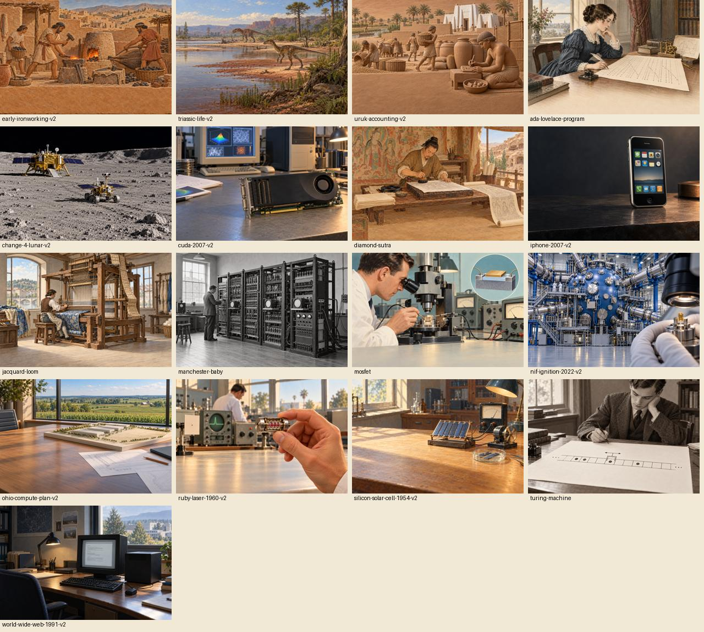

# 加速史图片巡检与历史节点补全 · 2026-10-27

巡检基线：49 个时代、262 个事件、149 个已有图片引用。检查了整批图片缩略图、重点原图、时代与器物特征，以及线上和本地观察窗。修正 13 处原有配图，为 4 个新增历史事件和 2 个已有关键节点补图；两组时代与事件共用同题材画面，合计生成 17 张原创插画、接入 19 套网页图片。事件总数由 262 增至 266，独立配图事件由 100 增至 106。

## 修正的原有配图

| 时代／事件 | 原图问题 | 新素材键 |
|---|---|---|
| 恐龙与哺乳动物 | 同一场景混用相隔亿年的动物与灭绝撞击 | `epochs/triassic-life-v2` |
| 城市与文字、楔形文字 | 早期乌鲁克场景混用后来的宏伟多层神庙和宫殿 | `epochs/uruk-accounting-v2`、`moments/uruk-accounting-v2` |
| 铁器时代（时代与事件） | 公元前1200年近东冶铁被表现为商周青铜纹样、铁犁和晚出圆钱 | `epochs/early-ironworking-v2`、`moments/early-ironworking-v2` |
| 1954年硅太阳能电池 | 现代封装光伏板和晚出城市建筑 | `moments/silicon-solar-cell-1954-v2` |
| 1960年激光器 | 巨型科幻装置、持续红光束和未来城市 | `moments/ruby-laser-1960-v2` |
| 1991年万维网 | CERN办公室混入后来投入使用的LHC式加速器 | `moments/world-wide-web-1991-v2` |
| 2007年iPhone | 现代全面屏手机 | `moments/iphone-2007-v2` |
| 2007年CUDA | 现代显卡和科幻机房 | `moments/cuda-2007-v2` |
| 2019年嫦娥四号 | 着陆器和巡视器缺乏清楚的任务硬件特征 | `moments/change-4-lunar-v2` |
| 2022年核聚变点火 | 把国家点火装置画成开放的发光巨型反应装置 | `moments/nif-ignition-2022-v2` |
| 2026年俄亥俄算力融资 | 八月规划被画成冬季已建成运行的园区 | `moments/ohio-compute-plan-v2` |

其中乌鲁克泥板与早期冶铁画面分别用于对应的时代和事件。时代总述概括后续演进，插画固定表现其中一个连贯场景。

## 补全的节点与图片

| 年份 | 节点 | 处理 |
|---|---|---|
| 868-05-11 | 雕版印刷《金刚经》 `diamond-sutra` | 新增事件、能力、中英文和配图；明确不是印刷术的发明日期 |
| 1804 | 提花机走向实用 `jacquard-loom` | 新增事件、能力、中英文和配图；区分1801年演示与1804年前后实用化 |
| 1843 | 洛夫莱斯程序 `ada-lovelace-program` | 为已有事件补专图 |
| 1936 | 图灵机 `turing-machine` | 为已有事件补专图；数学模型画在纸上 |
| 1948-06-21 | 首次运行电子存储程序 `manchester-baby` | 新增事件、能力、中英文和配图 |
| 1959 | MOS场效应晶体管 `mosfet` | 新增事件、能力、中英文和配图；区分1959年制成与1960年公开演示 |

事实、日期与一手来源见[历史节点核查](../../../docs/chronicle/history-additions-2026-10-27.md)。逐图复核记录：[技术史](tech-audit.md)、[时代与规划](scope-audit.md)、[新增与补图](new-event-art.md)。所有图片都是AI生成的题材复原或原理示意，不能作为历史照片、考古证据、精确工程结构或项目进度证据。

## 本批另外五张画面的历史约束

- 乌鲁克：使用泥板记账、泥筹、谷物仓储和简单泥砖院落，移除晚出宏伟宫殿；依据[大都会博物馆的晚乌鲁克印章及建筑图像](https://www.metmuseum.org/art/collection/search/326721)。
- 早期冶铁：地区和技术分期依据[近东铁冶金研究](https://doi.org/10.1007/s10814-019-09129-6)，画面表现小型木炭炉、手动鼓风和锻打，不将各地铁器时代等同于同一年。
- 激光器：使用短红宝石和螺旋氙闪光灯；依据[史密森学会梅曼激光器部件](https://www.americanhistory.si.edu/collections/object/nmah_712855)、[HRL首次激光器历史](https://www.hrl.com/about/laser)。第一版生成装置仍过大，已二次编辑为手指间小型器物，移除发光线圈和光束。
- 嫦娥四号：金色无人着陆器、太阳翼、六轮玉兔二号；月背天空不出现地球或肉眼可见的中继星。依据[CNSA任务与互拍记录](https://www.cnsa.gov.cn/english/n6465719/c6805233/content.html)。
- 核聚变：封闭的球形靶室、分布式束线与诊断端口，以及前景微型金色黑腔；依据[LLNL点火记录](https://www.llnl.gov/news/ignition)、[192束激光与微型靶的说明](https://www.llnl.gov/article/49626/laser-focused-power-finesse-drove-fusion-ignition-success)。画面使用不同尺度组合，前景是检视示意。

## 素材与复现

- `epochs/`、`moments/`：17张1536×1024原PNG和每张最终提示词。乌鲁克与冶铁的原PNG只保存一份。
- `apps/web/public/media/art/{epochs,moments}/`：19套800/1600 WebP及对应深度图。使用新素材键避免已有缓存继续展示旧图。
- WebP使用`cwebp -q 76 -resize <800|1600> 0`；4张技术史图使用质量68，见其核查记录。
- 深度使用现有`tools/make-depth.py`的Depth Anything V2 Small，按本批独立目录重新计算，未复用旧图深度。提花机窗外晚出地标已局部编辑移除，并重新计算该图深度。
- 旧网页三件套从public移除；旧1600版归档在`retired/{epochs,moments}/`，仅供既有壁纸历史映射追溯。`phone-editions-2026-10/manifest.json`只调整历史source路径，保留已生成壁纸与排期记录的原映射。
- 首访引导影片的“城市与文字”输入同步改为`uruk-accounting-v2`，字幕与时间保持不变；运行`bash tools/make-media.sh`使用本机ffmpeg重新构建16:9与9:16影片和首帧海报。输出使用`ascent-historical-v2-{16x9,9x16}.mp4`及对应`-poster.jpg`新文件名，播放器、CSS和首访预加载同时更新，避免缓存继续展示旧画面；首访预加载原来误指向的`hero-*-poster.jpg`也改为实际海报。其他影片时代输入保留，包括仍使用中的`agents`。

接入最新main时，文字与铁器工坊的加载图和“原画”窗口也改用新乌鲁克、早期冶铁素材，避免工坊继续请求已退役的图片。

## 验证

开发阶段（接入最新main之前）使用隔离的 Node 24.22.0 / PostgreSQL 17 环境检查：

| 检查 | 最终结果 |
|---|---|
| `npm run typecheck` | 通过 |
| Web生产构建 | 通过 |
| 后端全量 `npm test` | 1015通过、0失败、3跳过 |
| 前端全量，含Chromium与WebKit | 165通过、0失败、1跳过 |
| 全站smoke与MCP契约 | 通过 |
| 155套有效图片的双尺寸、解码与非平坦深度图 | 通过 |
| 19个变更场景的SSR主图选择与57个图片请求 | 通过 |
| 手机观察窗 | 新增节点、激光器、原代iPhone等目视通过 |

首轮检查暴露了引导影片的旧图引用，已修复并完成上述完整重跑。开发检查日志保存在本地`.data/chronicle-audit/`，不提交。接入最新main后，正式发布由 `deploy/update.sh` 重新验证精确提交，包含迁移、类型、构建、全套测试、smoke和MCP。

引导影片验证：`ffprobe`核对两版分辨率、24fps、H.264与约38.2秒循环时长；使用ffmpeg分别完整解码检查，并抽取“城市与文字”片段检查新乌鲁克画面及横竖裁切。该片段横向焦点改为0.85，使竖屏保留右侧泥板记账者。引导字幕同步与资源检查运行`node --test apps/web/tests/onboarding.test.ts`；重新构建Web后运行`node --test apps/web/tests/motion.test.ts`，覆盖SSR不提前请求影片、首访海报预加载实际存在及动效开关；本批两个测试文件共14项通过。
